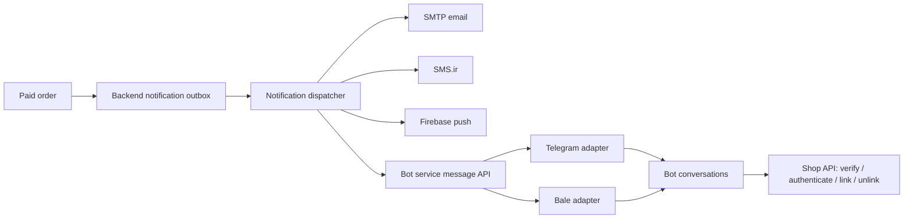

# Bot integrations service

Independent TypeScript/Express project for Telegram and Bale. It has its own
package, build, tests, process and encrypted Redis storage. It never imports shop
code, connects to tenant databases, checks passwords, assigns roles, or owns shop
notification policy. All shop operations go through `shop-backend` HTTP APIs.



## Run

Requires Node 20+ and Redis with persistence enabled. Production webhook mode
also requires public HTTPS for callbacks.

```sh
npm install
# Copy .env.example to .env and supply the real values.
npm run build
npm start
```

For development use `npm run dev`; for isolated mocked tests use `npm test`.
Generate `BOT_STORAGE_ENCRYPTION_KEY` with
`node -e "console.log(require('crypto').randomBytes(32).toString('hex'))"`.
Keep this key stable: changing it makes stored connections unreadable.

For local development, use `.env.local.example` as the reference and set
`BOT_UPDATE_MODE=polling`, `NODE_ENV=development` and
`SHOP_BACKEND_URL_TEMPLATE=http://localhost:3000`. Restart both services before
clicking setup. The service validates the bot and removes its webhook, then polls
for updates. `localhost` can be entered in the bot. No public callback/tunnel is
needed; the server still needs network access to the Telegram/Bale API. Polling
offsets survive restarts and share the webhook deduplication/command handler.
Polling mode and HTTP loopback backend overrides are rejected in production.

For V2Ray, an explicit messenger-only HTTP CONNECT proxy can be configured with
`TELEGRAM_PROXY_URL=http://127.0.0.1:10808` (use your actual HTTP/mixed listener port).
`BALE_PROXY_URL` is independent and can remain empty. A SOCKS-only URL is not accepted.
Keep `TELEGRAM_API_BASE_URL=https://api.telegram.org`: the proxy URL is a separate
transport setting, not an API endpoint. This proxy is not used for Redis or local
shop API requests. Tunnel mode still needs working routes to the provider; an
accepted CONNECT followed by TLS timeout indicates an upstream/network issue.
Restart the bot service after changing these settings.

The service waits until Redis is ready before starting polling or reporting that it
has started. Storage failures include a safe error code. `BOT_STORAGE_DECRYPTION_FAILED`
means persisted connections were encrypted with a different key: restore the original
`BOT_STORAGE_ENCRYPTION_KEY` rather than generating another one or deleting records.

`PROVIDER_UNREACHABLE` means the service cannot reach the messenger API, not that
the bot token was rejected. Check server network/VPN access or a trusted provider
API proxy. `PROVIDER_TOKEN_INVALID` means the provider actually rejected the token.
The setup API returns a safe `code` and `stage` rather than logging credentials.

Set the same random `BOT_SERVICE_API_KEY` (at least 32 characters) in this project
and `shop-backend`. Set `BOT_SERVICE_URL` in the backend to this service's trusted
base URL. Use TLS for service traffic or an isolated trusted internal network.
No shared master key is sent over HTTP: both directions derive tenant credentials
using HMAC-SHA256(master, `shop-bot:<tenantId>`). The backend checks the credential
against the tenant resolved from the request hostname, not the body alone.

`SHOP_BACKEND_URL_TEMPLATE` is an operator-controlled HTTPS **origin** template, for example
`https://api.{domain}`. It must not include `/api/bots/service` or another API path.
The only development exception is a static loopback HTTP origin such as
`http://localhost:3000`; arbitrary insecure remote origins remain disallowed.
Only normalized enrolled shop domains
are inserted. User-entered messages never supply an API URL. Redirects are denied.

The URLs and keys have different purposes:

| Configuration | Purpose |
| --- | --- |
| `PUBLIC_BASE_URL` | Public URL of this integration service, used for provider callbacks |
| `SHOP_BACKEND_URL_TEMPLATE` | Shop backend origin for normal user and management API calls |
| `TELEGRAM_API_BASE_URL` | Telegram API origin; defaults to `https://api.telegram.org` |
| `BALE_API_BASE_URL` | Bale API origin; defaults to `https://tapi.bale.ai` |
| Admin configuration `telegram.botKey` | Token received from Telegram BotFather for this shop |
| Admin configuration `bale.botKey` | Token received from Bale's bot creator for this shop |
| `BOT_SERVICE_API_KEY` | Internal shared master key between our services; never a BotFather token |

Provider URL overrides are optional and must use HTTPS. Use only trusted provider
proxies: provider tokens are sent to those endpoints. Tokens are entered through
the shop admin configuration screen, then setup securely provisions this service.

### Optional single-file Telegram relay

If the integration host cannot reach Telegram, copy only
`scripts/telegram-relay.cjs` to a server that can. It needs Node 20+, no npm install.
Generate a separate random key (do not reuse the shop service key or bot token):

```sh
node -e "console.log(require('crypto').randomBytes(32).toString('hex'))"
# On the relay host (POSIX shell):
export TELEGRAM_RELAY_API_KEY='<generated-key>'
node telegram-relay.cjs
```

The relay listens on `127.0.0.1:3020` by default (`HOST`/`PORT` override it).
Put an HTTPS reverse proxy in front of it, forwarding paths unchanged. Disable
access logging for `/bot...` paths: those paths contain BotFather tokens.
The relay host and TLS proxy must be trusted with bot tokens and message content.
Run it under your normal process supervisor for restart on failure.

In `integrations-bots/.env`, set:

```dotenv
TELEGRAM_API_BASE_URL=https://telegram-relay.your-domain.com
TELEGRAM_RELAY_API_KEY=<same-generated-key>
TELEGRAM_PROXY_URL=
```

Restart `integrations-bots`. Existing Telegram setup, polling and send operations
now use the relay; bot tokens still come from the shop admin configuration.
Webhook updates still go directly to `PUBLIC_BASE_URL`, so webhook mode needs
public HTTPS on the integration service. The relay only forwards authenticated
JSON Bot API requests, not file uploads/downloads. It preserves Telegram error
responses, including rate limits, and never forwards arbitrary destination URLs.
Leave the relay key empty and restore `https://api.telegram.org` for direct access.

Invalid messenger URL, proxy or relay-key configuration logs a warning and disables
only that provider until configuration is corrected and the service restarted.
The service and other provider remain available. Disabled provider operations
return HTTP 503 with `PROVIDER_CONFIGURATION_INVALID`; webhooks return 503 so
updates can be retried. No direct Telegram fallback bypasses the configured relay.

## Activate a shop

1. Apply both tenant migrations in order using the existing provisioning workflow:
   `20261103000000-create-bot-integration.js`, then
   `20261103010000-create-notification-deliveries.js`.
2. Start this service and the updated backend. Configure `telegram.botKey` and/or
   `bale.botKey` in the admin panel, enable the key, then click setup for that provider.
3. Each shop/provider needs its own bot. The service checks the shop context through
   the backend API, claims bot ownership, registers the webhook, then stores its
   connection encrypted with AES-256-GCM. The backend stores a connection reference
   and token fingerprint. Tokens changing requires setup again.
4. In Telegram/Bale send `/start`, the shop domain, panel staff username/phone, password.
   The service deletes the password message before forwarding it to the backend.
   The service calls the normal `POST /api/users/login` route and stores the normal
   access/refresh tokens encrypted. Login supports the existing `phoneNumber` field
   or a `username` identifier and follows the backend's shared authentication policy.
   It then links the provider identity using the ordinary bearer token. Only the
   identity-link operation is bot-specific; password authentication is not duplicated.
   Panel staff can link for future commands using their normal permissions; paid-order
   notifications remain restricted to active Admin/SuperAdmin recipients.
   No password is persisted in either bot sessions, outbox payloads, or logs.
5. `/status` checks current shop authorization. `/stop` or `/unlink` revokes the
   shop link; `/cancel` clears the ten-minute linking session. The admin panel can
   also revoke recipients and retry failed notifications.

## Reusing shop APIs for commands

`ShopBackendClient.requestForUser(connection, externalUserId, method, path, body?)`
calls ordinary shop APIs using that user's access token and `application-name:
adminpanel`. For example, a command can call `GET /api/users/select-list` or an
existing product/order endpoint; the normal backend authentication and permission
middleware decides whether that user may perform the operation. The internal
service credential never bypasses user permissions on management endpoints.

On access-token expiry, the client calls the existing `POST /api/users/refresh-token`
route with the standard refresh token and retries once. Invalid refresh clears the
encrypted session and requires `/start` again. Existing backend session/refresh
policies apply equally to bot and panel logins. Session storage has an additional
`BOT_SESSION_TTL_SECONDS` retention limit and never stores passwords.

`register(connection, {phoneNumber, password})` uses the ordinary `/api/users/register`
route for a future customer-registration command. It does not assign an admin role;
shop-management linking requires an existing authorized panel account. No automatic
account registration is performed by `/start`.

The remaining bot-specific backend APIs are for service provisioning/context and
authenticated identity linking/unlinking/status. Account endpoints require both a
normal authenticated shop user and tenant-scoped integration proof. They associate
a provider identity with `req.userId`; callers cannot select another shop user ID.

Chats with bots are not end-to-end encrypted. Deletion is a best effort offered
by the provider; this implementation fails closed if the deletion call fails.
Real credentials and messages are not used by automated tests.

## Generic text API

`POST /v1/messages` sends arbitrary text through either registered provider.
The endpoint is for authenticated server callers, never a public browser API.

```json
{
  "tenantId": "shop-tenant-id",
  "provider": "bale",
  "chatId": "123456789",
  "text": "Your custom message",
  "idempotencyKey": "notification:42:bale:recipient:7"
}
```

Header: `Authorization: Bearer <tenant-derived-credential>`. `shop-backend`'s
`botServiceClient` generates this automatically. `chatId` can be a numeric chat
ID or an `@channel_username` where the bot has posting access. Text is limited to
4096 characters. Reusing a key for the same payload returns `duplicate: true`;
reusing it for different text or recipient returns 422. Keys are retained seven days.
If the key is omitted a fresh one is generated, so the caller should supply a stable
key whenever retrying an operation.

`POST /v1/connections` is the authenticated provisioning API used by the backend:
`{tenantId, domain, provider, token}`. It returns `{connectionId, username, url}`
without credentials. `/health` is a process-liveness endpoint.

Provider webhooks enter `/webhooks/:connectionId/:secret`. Telegram additionally
requires its secret header. Bale uses the unguessable URL secret; it is not assumed
to support Telegram's extra webhook parameters. Proxy/access logging must redact
these callback paths. Private messages only are processed for account linking;
group messages and edited/unsupported updates are ignored. Update IDs are
deduplicated per connection and chat updates use short Redis leases.

## Notification ownership

`shop-backend/src/services/notifications` owns channels, availability checks,
event payloads, recipients and durable per-channel retries. The service here owns
only provider delivery and bot commands. Adding a new bot platform means a new
provider adapter/registry entry here and a channel/configuration entry in the backend.
Future shop notification preferences belong in the backend dispatcher policy.

Paid-order notifications target current active Admin/SuperAdmin accounts. The
backend queues each usable channel in the same transaction as order finalization.
Unconfigured transports are skipped. Email uses SMTP, SMS uses the existing SMS.ir
client, push uses existing Firebase credentials and a recipient token, and bot
channels use active shop links plus registered service connections. There are no
console-only transports returning fake delivery success.

Database leases and retries survive backend restarts. Provider failures are isolated
per channel and honor retry-after. In-app writes commit atomically with their outbox
status. Outbound provider delivery remains at least once: a process can crash after
a provider accepts a message but before persistence completes. Stable bot API
idempotency keys reduce duplicates, but cannot remove that final provider-side gap.

The backend migrations create account bindings and the shared notification outbox.
There is no separate bot-delivery table or in-backend provider worker. Run the
migrations, start both services, and connect each bot from the admin panel so its
callbacks point to this project.

Live acceptance checks still require actual bot tokens, reachable shop domains,
public callback HTTPS, and configured notification providers. No live deployment,
webhook registration, database migration or real notification is performed by tests.

Provider references: [Telegram Bot API](https://core.telegram.org/bots/api),
[Bale bot documentation](https://docs.bale.ai/).
